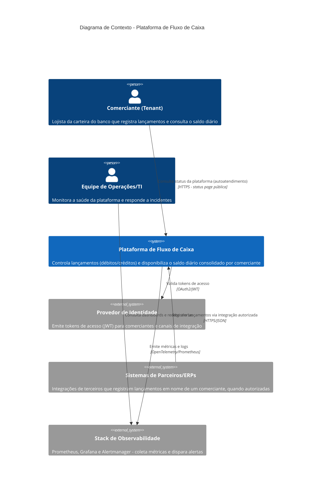

# C4 - Nível 1: Diagrama de Contexto

Visão geral do sistema de Fluxo de Caixa no contexto de seus usuários e sistemas externos, considerando a premissa de plataforma multi-tenant (ver `../business-assumptions.md`).

## Observações

- O "Comerciante" representa qualquer tenant da carteira, independentemente de porte — a arquitetura trata um comerciante pequeno e uma rede de lojas maior da mesma forma no nível de contexto, diferenciando-os apenas na camada de quota elástica (ADR-009).
- "Sistemas de Parceiros/ERPs" é um ator externo opcional, previsto pela premissa de múltiplos canais de integração (`business-assumptions.md`), mesmo que não implementado como integração real no escopo deste desafio.
- O Provedor de Identidade é tratado como sistema externo no nível de contexto; no desenho interno (nível de container), sua responsabilidade é simplificada para o escopo do desafio (ver `c2-containers.md`).
