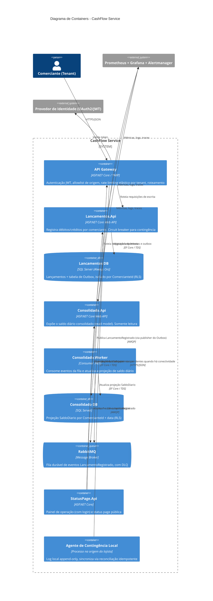

# Diagrama de Containers

Decomposição interna da plataforma em seus componentes implantáveis.

`Lancamentos.Api` e `Consolidado.Api`/`Consolidado.Worker` não possuem nenhuma dependência de chamada síncrona direta entre si — toda comunicação de negócio passa pelo RabbitMQ.
