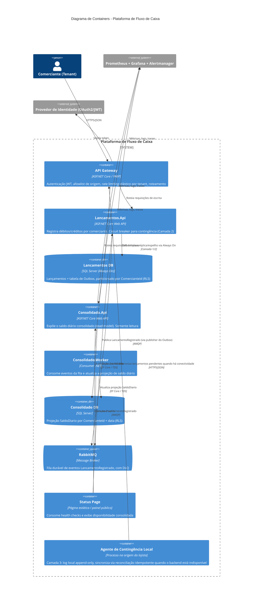

# C4 - Nível 2: Diagrama de Containers

Decomposição interna da plataforma em seus componentes implantáveis.

## Observações

- `Lancamentos.Api` e `Consolidado.Api`/`Consolidado.Worker` não possuem nenhuma dependência de chamada síncrona direta entre si — toda comunicação passa pelo RabbitMQ, reforçando visualmente o isolamento descrito no ADR-001 e ADR-002.
- O `Agente de Contingência Local` é desenhado como componente lógico de terceira camada de resiliência (ADR-007); no escopo deste desafio, é implementado como prova de conceito simplificada (ver `camada-3-contingencia.md`).
- O `API Gateway` concentra autenticação, controle de origem e rate limiting elástico para que `Lancamentos.Api` e `Consolidado.Api` não precisem reimplementar essas preocupações individualmente — mas cada serviço também valida o claim de tenant localmente como defesa em profundidade, nunca confiando cegamente no cabeçalho recebido do Gateway sem revalidação.
